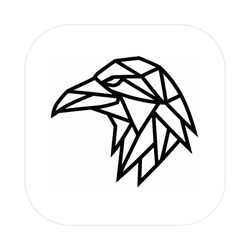
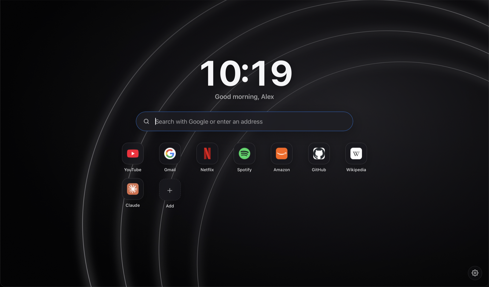

<p align="center">
  
</p>

<h1 align="center">Rook</h1>

<p align="center">
  A calm, beautiful and private new tab page.<br>
  Glass look, your favorites, your search engine – and nothing else.
</p>

<p align="center">
  
</p>

<p align="center">
  <a href="https://richyboehm.github.io/rook/download/"><b>Download Rook for Mac</b></a>
</p>

## Why Rook?

Most new tab pages are either plain or full of news, ads and tracking. Rook gives you a polished, Apple-style start page while your browser keeps doing what it does best: security, passwords, sync and updates.

- **Beautiful** – dark glass design, large clock with greeting, four hand-made backgrounds or your own photo
- **Private** – no account, no server, no analytics. Everything is stored locally in your browser
- **Fast** – plain HTML, CSS and JavaScript. No framework, no build step, under 100 KB of code
- **Easy** – a short welcome flow sets up your name, search engine, background and favorites
- **Yours** – add, edit and reorder favorites right on the page, choose an accent color, export a backup
- **Bilingual** – English and German, picked automatically from your browser

## Use it

### Option 1: Online (no download)

Open **https://richyboehm.github.io/rook/** and set it as your home and new tab page (see below).

### Option 2: Locally

1. Download this repository (**Code → Download ZIP**) and unzip it somewhere permanent, e.g. your Documents folder.
2. Open `index.html` once in your browser to check it works.
3. Set the file address (e.g. `file:///Users/you/Documents/rook/index.html`) as your home and new tab page.

## Set it as your new tab page

**Safari (Mac)**
Safari → Settings → General:
- *Homepage*: the Rook address
- *New windows open with*: Homepage
- *New tabs open with*: Homepage

**Firefox**
Settings → Home → *Homepage and new windows*: Custom URLs → the Rook address.
Firefox does not allow custom new tab pages by default – use the add-on *New Tab Override* for that.

**Chrome, Edge, Brave**
Settings → On startup → *Open a specific page* → the Rook address.
For new tabs, these browsers require an extension that redirects the new tab page to a URL of your choice.

## Rook Browser for Mac

Rook is also a standalone Mac browser: its own app and window, with Rook as the start page in every new tab. Pages are rendered by **WebKit, Safari’s engine**, so it gets the same security updates with every macOS update, plus Apple’s fraudulent website warning.

- Rook’s own tab bar in a glass look: favicons, pinned tabs, drag to reorder, right-click menu (pin, duplicate, move to new window, close others)
- Address bar like Safari: shows just the site name while browsing, the full address when you click in; local suggestions from your favorites and history while typing (nothing is sent to a search engine)
- Settings window (⌘,): search engine, restore tabs, download folder or “always ask”, default browser, blocker and exceptions, per-site camera/microphone permissions and zoom
- Favorites: ⌘D adds the current page to the start page; import bookmarks from an HTML export of Safari, Chrome or Firefox
- History window (⌘Y): search, open, delete single entries or the last hour/today/everything
- Start page inside the app shows “Recently visited”; optional weather (off by default, uses open-meteo.com)
- Back/forward, zoom (remembered per site), find on page (⌘F), print (⌘P)
- Download bar with progress, pause/resume, retry and “Show in Finder”. Existing files are never overwritten, downloads are never opened automatically and carry macOS’ quarantine mark, so Gatekeeper checks them
- History menu, reopen closed tab (⇧⌘T), tabs are restored after quitting or a crash
- Private windows (⇧⌘N): cookies and website storage stay in memory and are gone when the last private window closes. Downloads and anything you save on purpose remain on your Mac, and your network provider can still see which sites you visit – private windows are not anonymity
- Links that would open another app (`mailto:`, `zoommtg:` …) always ask first; `file:` and `javascript:` links from websites are blocked
- Invalid certificates are never bypassed; `http://` sites open with a warning sign
- Clear history, or cookies and website data, from the History menu
- Can be set as your default browser
- **Ad and tracker blocker** (menu *Schutz*): uses WebKit’s built-in content blocker – the same technology as Safari content blockers – with the community lists [EasyList, EasyPrivacy and EasyList Germany](https://easylist.to/). Blocked requests are never loaded, ad boxes are hidden. Can be switched off globally or per website (⌥⌘B)

**How good is the blocker?** Banner ads, ad pop-ups and most trackers are blocked reliably – about the level of well-known Safari content blockers. It cannot remove ads inside YouTube videos, get around “please disable your ad blocker” walls, or hide sponsored posts that look like normal content (that would need scripts injected into pages, which WebKit’s blocker does not do). It also cannot count what it blocked. Rule types that WebKit cannot express (regular expressions, script rules, procedural selectors, hiding exceptions) are skipped.

**Network connections Rook makes itself:** only the weekly download of the three filter lists from easylist.to (HTTPS, no cookies, nothing about you or your browsing is sent). No telemetry, no crash reports, no search suggestions. Website logos on the start page come from Google’s favicon service (can be switched off), and Apple’s fraudulent website warning is part of WebKit.

The filter lists are not part of this repository; they are downloaded at runtime and remain under [their own licence](https://easylist.to/pages/licence.html) (GPLv3 or CC BY-SA 3.0).

**Not included yet / not possible:**
- Password autofill and passkeys: Apple only allows these for browsers with a special entitlement from a paid developer account
- Safari extensions, iCloud tab sync, importing bookmarks from other browsers
- Muting tabs and an audio indicator (WebKit offers no public interface for this)
- Bookmark folders (imports are flattened, the start page shows up to 60 favorites)
- Automatic updates: rebuild from source to update

**Build it yourself** (needs Apple’s free Command Line Tools: `xcode-select --install`):

```sh
git clone https://github.com/richyboehm/rook.git
cd rook/browser
./build.sh
open build/Rook.app
```

Then move `Rook.app` into your Applications folder. Because you built it yourself, macOS opens it without a warning.

**Tests:** `browser/Tests/run.sh` (logic: address bar, link safety, downloads, filter conversion) and `browser/Tests/run-blocker.sh` (downloads the real filter lists and checks with the real WebKit engine that ads and trackers are blocked and that per-site exceptions work).

### Download page

The page in `download/` (online at https://richyboehm.github.io/rook/download/) offers `download/Rook.dmg`.
After a change to the app, run `browser/build.sh`, then `browser/make-dmg.sh`, and commit the new `Rook.dmg`.

## Keyboard shortcuts

| Key | Action |
|---|---|
| `/` | Jump to the search bar |
| `1` – `9` | Open favorite 1 to 9 |
| `Esc` | Close dialogs |

## Privacy

- All settings and favorites live in your browser’s `localStorage`. Nothing is sent anywhere.
- Your searches go directly to the search engine you chose.
- Website logos are loaded from Google’s favicon service. You can turn this off under **Settings → Privacy**; Rook then shows colored letters instead.
- Only `http` and `https` links are accepted as favorites, and imported backups are validated.

## Customize

Everything is in three small files:

| File | What’s inside |
|---|---|
| `index.html` | Page structure and dialogs |
| `style.css` | Colors, glass effect, layout |
| `app.js` | Logic, texts (English/German), search engines and suggested favorites |

To add a search engine, extend `ENGINES` in `app.js`. To change the suggested favorites in the welcome flow, edit `presets()`.

## Credits

The backgrounds *Obsidian*, *Aurora*, *Ember* and *Midnight* were generated for Rook and are covered by the same license as the code.

## License

[MIT](LICENSE) – free to use, change and share.

---

### Deutsch

**Rook** ist eine ruhige, schöne und private Startseite für deinen Browser: Uhr mit Begrüßung, große Suchleiste, deine Favoriten und ein Glas-Look im Apple-Stil. Alles wird nur lokal in deinem Browser gespeichert – kein Konto, kein Server, kein Tracking.

**Einrichten in Safari:** Safari → Einstellungen → Allgemein → bei *Homepage* die Rook-Adresse eintragen und bei *Neue Fenster öffnen mit* sowie *Neue Tabs öffnen mit* jeweils **Homepage** wählen.

Beim ersten Öffnen hilft dir eine kurze Begrüßung beim Einrichten. Später findest du alles über das Zahnrad unten rechts.
